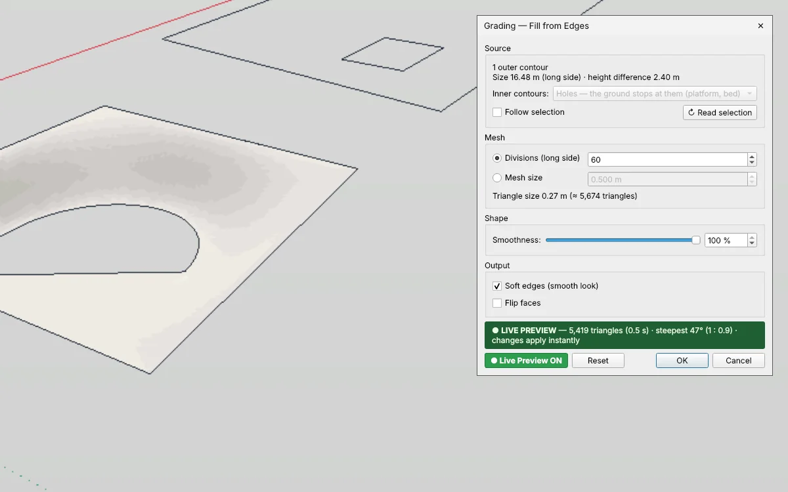

# Grading — freie Flächen mit Gelände füllen für IngeTrazo

Füllt die freie Fläche zwischen Kanten — Weg, Terrasse, Rampe, abgesenkter Platz — mit **weichem, organischem Gelände**, das jede Kante genau trifft, wie von Hand angelegt. Die Kanten dürfen auf verschiedenen Höhen liegen.

[English → README.md](README.md)

## Installation
1. In IngeTrazo: **Extensions ▸ Open plugins folder** (Windows: `%APPDATA%\ingetrazo\plugins\`, Linux: `~/.local/share/ingetrazo/plugins/`).
2. `grading_tool.py` in diesen Ordner kopieren.
3. IngeTrazo neu starten → **Extensions ▸ Grading ▸** *Fill from Edges… · Edit Grading…* (auch im Rechtsklick-Menü).

Benötigt IngeTrazo ≥ 0.5.6 (Extension-API 2) · getestet mit IngeTrazo 0.6.0. Ein Beispielmodell liegt in [`examples/grading_examples.igz`](examples/grading_examples.igz).

## Bedienung
Die Kanten rund um die freie Fläche auswählen (lose Kanten und/oder Gruppen aus Kanten) und **Fill from Edges…** aufrufen.

- Die **größte geschlossene Kontur** (von oben gesehen) ist die äußere Kontur. Geschlossene Konturen darin sind innere Konturen: **Holes** (Plattform oder Beet, an dem das Gelände endet) oder **Fixed lines** (das Gelände läuft daran vorbei weiter).
- **Offene Kantenzüge** innen sind feste Linien (Mulde, Rücken); ausgewählte **Hilfspunkte** (Tape Measure) sind Höhenpunkte.
- **Smoothness** — 100 % lässt das Gelände an jeder Kante flach auslaufen und rundet Böschungsober- und -unterkante aus; 0 % ergibt gerade Böschungen mit Knick an den Kanten.
- **Divisions / Mesh size** bestimmen die Dichte des Dreiecksnetzes; der Dialog zeigt die Dreiecksanzahl und die **steilste Neigung** (° und 1 : n).
- **Live Preview** zeigt das Gelände im Modell, während der Dialog offen bleibt (Orbit, Pan, Zoom gehen weiter); **OK** übernimmt die aktuelle Vorschau ohne Neuberechnung.
- Das Ergebnis ist **eine Gruppe**, die ihre Kanten und Einstellungen kennt — auswählen und **Edit Grading…** aufrufen, um sie zu ändern. Ein Rückgängig-Schritt pro Aufruf.

## Einheiten
Der Dialog arbeitet in den **Einheiten des geöffneten Dokuments** — eingestellt in IngeTrazo unter **Fenster ▸ Einheiten…** (Strg+U) oder **Fenster ▸ Einstellungen… ▸ Einheiten**:
- Längenfelder zeigen und lesen die Längeneinheit und -form des Dokuments: m, cm, mm, in, ft, Fuß-Zoll (`9'10"`) oder Fuß-Zoll mit Brüchen (`9'10 1/8"`).
- Eingabe mit oder ohne Einheit: `25`, `2,5 cm`, `1'2"`, `3/4"`. Eine Zahl ohne Einheit gilt in der Dokumenteinheit (im Fuß-Zoll-Dokument: Zoll); ein Wert in einer anderen Einheit wird umgerechnet.
- Winkel stehen in der Winkeleinheit des Dokuments (Grad, Radiant oder Gon), Flächen in seiner Flächeneinheit; Prozentfelder und Anzahlen haben keine Einheit. Das Dezimaltrennzeichen folgt dem Dokument — beim Tippen gehen `.` und `,`.
- Ein Wechsel der Einheiten ändert nur Anzeige und Eingabe — das Modell bleibt exakt gleich. Nach dem Ändern den Dialog neu öffnen.
- In IngeTrazo-Versionen vor 0.5.8 sind die Felder einfache Zahlen in Metern.
- Höhen, Versätze und Abstände sind Längen in der Dokumenteinheit; **Smoothness** steht in Prozent.

## Änderungen
- **1.2** — **Dokumenteinheiten**: Dreiecksgröße und die Maße im Dialog zeigen und lesen die Einheiten aus Einstellungen ▸ Einheiten, Zahlen mit dessen Dezimaltrennzeichen. Getestet mit IngeTrazo 0.6.0.
- **1.1** — eigene Werkzeugleiste **Grading** mit einem Icon je Befehl (Fill from Edges… · Edit Grading…). Sie erscheint in einer eigenen Zeile unter den eingebauten Leisten und lässt sich wie diese verschieben, abdocken oder ausblenden (Rechtsklick auf eine Leiste). Icons im Stil von IngeTrazo, passend zum hellen/dunklen Theme.
- **1.0** — erste Veröffentlichung.

## Lizenz
GPL-3.0-or-later · © 2026 Pesi (pesi3d.de) · [Impressum](https://pesi3d.de)
